# FortiGate NSI (Network Security Integration) Terraform Configuration

**Experimental**
 
This Terraform configuration deploys FortiGate Network Service Insertion (NSI) infrastructure on Google Cloud. It creates VPC networks, subnets, FortiGate instances in zonal unmanaged instance groups, load balancer components, and the NSI resources required for traffic inspection.

```mermaid
flowchart LR
    %% FortiGate NSI on GCP. One FortiGate, unmanaged instance group, forwarding
    %% rule and intercept deployment is created per zone in var.zones; two zones
    %% are shown. Names assume the default prefix "fgt-nsi".

    subgraph CONSUMER["Consumer side · workload VPCs"]
        direction TB
        subgraph DEMO["Demo workload · deploy_web_servers = true"]
            direction TB
            WEB["Web VPC · 10.12.0.0/24<br/>Debian 12 web servers<br/>Apache · iperf3"]
            WEB2["Web2 VPC · 10.13.0.0/24<br/>Debian 12 web servers<br/>Apache · iperf3"]
        end
        OWN["Your VPCs<br/>nsi_consumer_vpc_names"]
        NCC["NCC hub · full mesh<br/>VPC spokes"]
        WEB <--> NCC
        WEB2 <--> NCC
        OWN <--> NCC
    end

    subgraph NSI["NSI · managed by Terraform"]
        direction TB
        FWP["Global network firewall policy<br/>newfgt-nsi<br/>rule 10 ingress · rule 11 egress<br/>0.0.0.0/0 → apply profile group"]
        SPG["Security profile group (project)<br/>&lt;project&gt;-ftnt-spg1<br/>+ custom intercept profile -sp1"]
        EPG["Intercept endpoint group<br/>newfgt-nsi-ftnt-epg"]
        DG["Intercept deployment group<br/>newfgt-nsi-ftnt-dg"]
        DEP["Intercept deployments<br/>fgt-nsi-&lt;zone&gt; · one per zone"]
        FWP --> SPG --> EPG --> DG --> DEP
    end

    subgraph PRODUCER["Producer side · Inspection VPC · 10.50.160.0/24"]
        direction TB
        subgraph LB["Internal passthrough load balancer"]
            direction TB
            FR["Forwarding rules<br/>fgt-&lt;zone&gt; · UDP 6081<br/>reserved IP per zone"]
            BES["Backend service (UDP)<br/>session affinity CLIENT_IP<br/>health check TCP 8080"]
            FR --> BES
        end
        subgraph ZA["Zone A"]
            FGT_A["FortiGate-VM<br/>unmanaged instance group"]
        end
        subgraph ZB["Zone B"]
            FGT_B["FortiGate-VM<br/>unmanaged instance group"]
        end
        NAT["Cloud NAT"]
        BES --> FGT_A
        BES --> FGT_B
    end

    subgraph MGMT["Management VPC · 10.50.180.0/24"]
        MGMT_NET["port2 · external IP per FortiGate"]
    end

    ADMIN(["Admin"])
    FORTICARE(["FortiCare / FortiGuard<br/>FortiFlex licensing"])

    %% Associations managed per consumer VPC by Terraform
    FWP -. "policy association" .-> CONSUMER
    EPG -. "endpoint group association" .-> CONSUMER
    DEP -->|references| FR

    %% Intercepted traffic
    CONSUMER ==>|"intercepted traffic<br/>Geneve UDP 6081"| FR

    %% Management and egress
    ADMIN -->|"HTTPS 8443 · SSH 22"| MGMT_NET
    MGMT_NET --- FGT_A
    MGMT_NET --- FGT_B
    FGT_A -.-> NAT
    FGT_B -.-> NAT
    NAT -.-> FORTICARE

    %% Styling
    classDef ext fill:#f3e5f5,stroke:#7b1fa2
    classDef fgt fill:#ffecb3,stroke:#ef6c00
    classDef lb fill:#c8e6c9,stroke:#2e7d32
    classDef nsi fill:#ffcdd2,stroke:#c62828
    classDef workload fill:#e1f5fe,stroke:#0277bd
    classDef net fill:#b3e5fc,stroke:#0277bd

    class ADMIN,FORTICARE ext
    class FGT_A,FGT_B fgt
    class FR,BES,NAT lb
    class FWP,SPG,EPG,DG,DEP nsi
    class WEB,WEB2,OWN workload
    class MGMT_NET net
```




<sub>Diagram source: [architecture-diagram.mmd](architecture-diagram.mmd)</sub>


## Architecture Overview

This deployment creates:

### VPC Networks
- **Inspection VPC** (`fgt-nsi-ib-new`): Data/traffic inspection network (10.50.160.0/24)
- **Management VPC** (`fgt-nsi-ib-new-mgmt`): FortiGate management network (10.50.180.0/24)  
- **Web VPC** (`fgt-nsi-ib-new-web`): Public web network (10.12.0.0/24)

### FortiGate Infrastructure
- **Instance Template**: FortiGate VM template with dual network interfaces
- **Unmanaged Instance Groups**: Zonal groups for the FortiGate instances
- **Health Checks**: TCP health checks for the load balancer backend service
- **Load Balancer**: Internal UDP load balancer for Geneve traffic (port 6081)
- **Forwarding Rules**: Three zone-specific forwarding rules for NSI deployment

### NSI (Network Security Inspection) Components
- **Intercept Deployment Group**: Global deployment group for FortiGate NSI
- **Intercept Deployments**: Zone-specific intercept deployments linking forwarding rules
- **Intercept Endpoint Group**: Endpoint group for traffic interception
- **Intercept Endpoint Group Association**: Associations with the web VPCs and any `nsi_consumer_vpc_names`
- **Security Profiles**: Custom intercept security profile for traffic processing
- **Security Profile Group**: Group containing the custom intercept profile
- **Firewall Policy**: Network firewall policy with NSI rules for ingress/egress traffic
- **Firewall Policy Association**: Policy associations with the web VPCs and any `nsi_consumer_vpc_names`

### Test Infrastructure (optional)
- **Web Server VMs**: Debian 12 instances across three zones for testing NSI functionality, preloaded with Apache and iperf3
- **Web / Web2 VPCs**: Two workload VPCs connected through an NCC full mesh hub

All of the test infrastructure is controlled by `deploy_web_servers` (default `true`). Set it to `false` to deploy only the FortiGate NSI producer side. List workload VPCs to inspect in `nsi_consumer_vpc_names`.

### Network Connectivity Center

Terraform creates an NCC hub and one VPC spoke per workload VPC. With `deploy_web_servers = true`, the two demo web VPCs join the hub. With `deploy_web_servers = false`, set `ncc_existing_vpc_names` to the existing VPC names to connect. The hub explicitly uses the **MESH** topology; every spoke exchanges its private subnet routes with every other spoke. The inspection and management VPCs are not NCC spokes.

```hcl
deploy_web_servers     = false
ncc_existing_vpc_names = ["two-gke-a-vpc", "two-gke-b-vpc"]
```

`ncc_existing_vpc_names` controls routing. To inspect those VPCs with NSI, also include them in `nsi_consumer_vpc_names`. NCC connectivity does not change firewall policy evaluation or automatically allow traffic.

To migrate an existing demo deployment, remove the two Terraform-managed VPC peerings before creating the NCC spokes: Google Cloud does not allow the same two VPCs to be both directly peered and spokes on one NCC hub. After updating this configuration, run:

```bash
terraform apply \
  '-target=google_compute_network_peering.web_to_web2[0]' \
  '-target=google_compute_network_peering.web2_to_web[0]'
terraform apply
```

The first apply removes the old peerings; the second creates the NCC hub and spokes. Expect a short connectivity gap. Check `terraform plan` before each apply. [Google Cloud's VPC spoke guidance](https://docs.cloud.google.com/network-connectivity/docs/network-connectivity-center/concepts/vpc-spokes-overview) describes the peering restriction.

### Security
- **Firewall Rules**: Allow all ingress/egress traffic on all VPCs plus health check rules
- **Network Interfaces**: Dual-interface setup (inspection + management)
- **Service Account**: Cloud Platform scope for GCP API access

## Prerequisites

1. **GCP Project**: Active GCP project with billing enabled
2. **APIs Enabled**: 
   - Compute Engine API
   - Cloud Resource Manager API
3. **Permissions**: IAM permissions for creating compute resources
4. **Terraform**: Version >= 1.0.0

## Quick Start

### 1. Clone and Setup
```bash
git clone <your-repo-url>
cd gcp-nsi
```

### 2. Configure Variables
```bash
cp terraform.tfvars.example terraform.tfvars
```

Edit `terraform.tfvars` with your specific values:
```hcl
project_id      = "your-gcp-project-id"
organization_id = "your-gcp-organization-id"
region          = "us-central1"
prefix          = "fgt-nsi"
admin_password = "YourSecurePasswordHere!"
```

### 3. Initialize and Deploy
```bash
terraform init
terraform plan
terraform apply
```

### 4. Access FortiGates
After deployment, FortiGate instances will have public IP addresses for management access:
- URL: `https://<fortigate-ip>:8443`
- Username: `admin`
- Password: As specified in `admin_password` variable

## Configuration Variables

### Required Variables
- `project_id`: Your GCP project ID
- `region`: GCP region for deployment (default: us-central1)
- `admin_password`: FortiGate admin password

### Optional Variables
- `fortigate_machine_type`: VM machine type (default: c4-standard-4)
- `fortigate_instance_count`: Number of FortiGate instances (default: 3)
- `zones`: Availability zones for instance distribution
- `prefix`: Resource naming prefix (default: fgt-nsi)
- `admin_port`: FortiGate admin port (default: 8443)
- `deploy_web_servers`: Deploy the demo web/web2 VPCs, NCC spokes, firewall rules and web server VMs (default: true)
- `ncc_existing_vpc_names`: Existing VPCs to join to the full mesh NCC hub (default: none)
- `nsi_consumer_vpc_names`: Existing VPCs to associate with the NSI endpoint group and firewall policy (default: none)
- `nsi_name_prefix`: Optional prefix for security profile names (default: project ID)
- `nsi_security_profile_scope`: `project` (default) or `organization`; organization scope requires organization IAM
- `organization_id`: Required only when `nsi_security_profile_scope = "organization"`

### Network Customization
- `inspection_subnet_cidr`: Inspection subnet CIDR (default: 10.50.160.0/24)
- `management_subnet_cidr`: Management subnet CIDR (default: 10.50.180.0/24)
- `web_subnet_cidr`: Web subnet CIDR (default: 10.12.0.0/24)

## NSI Integration

`terraform apply` creates the deployment group, zonal deployments, endpoint group, security profile and group, and `newfgt-nsi` firewall policy. It attaches the endpoint group and policy to both demo web VPCs when `deploy_web_servers = true`.

The security profile and group default to project scope. This fits the project-level global network firewall policy and uses project IAM. To share profiles at organization scope, set `nsi_security_profile_scope = "organization"` and grant the deploying identity `roles/networksecurity.securityProfileAdmin` on the organization.

### Inspecting your own VPCs

Set `nsi_consumer_vpc_names` to existing VPC names in `project_id`:

```hcl
nsi_consumer_vpc_names = ["prod-vpc", "staging-vpc"]
```

For each network Terraform creates:
- an endpoint group association named `newfgt-nsi-epga-<network>`
- a firewall policy association named `newfgt-nsi-fpa-<network>`

Long association names are shortened with a hash suffix. The FortiGate inspection and management VPCs must not be listed as consumers.

What to know before you add a VPC:
- **Rules 10 and 11 match all IPv4 traffic.** Customize them before attaching production VPCs.
- **A VPC can have only one global network firewall policy.** Check for an existing policy before adding a consumer.
- **Classic firewall rule order matters.** A classic allow or deny rule can stop traffic before the NSI policy when the VPC uses `AFTER_CLASSIC_FIREWALL`. Review [firewall policy evaluation order](https://docs.cloud.google.com/firewall/docs/firewall-policies-rule-eval-order).
- **Existing manually created NSI resources require import.** Import each matching resource into Terraform state before applying, so Terraform adopts it instead of trying to create a duplicate. See [SETUP_GUIDE.md](SETUP_GUIDE.md).

## File Structure

```
gcp-nsi/
├── main.tf                 # Provider configuration and locals
├── variables.tf            # Input variables
├── outputs.tf              # Output values
├── networks.tf             # VPC networks and subnets
├── firewall.tf             # Firewall rules
├── ncc.tf                  # NCC hub and VPC spokes
├── nsi_intercept.tf        # NSI groups, profiles, rules, and associations
├── instance_group.tf       # FortiGate instances and instance groups
├── health_check.tf         # Load balancer health checks
├── backend_service.tf      # Load balancer backend service
├── forwarding_rules.tf     # Internal load balancer forwarding rules
├── templates/
│   └── fortigate-config.tpl # FortiGate configuration template
├── terraform.tfvars.example # Example variables file
└── README.md               # This file
```

## Outputs

The configuration provides detailed outputs including:
- VPC and subnet details
- FortiGate instance group information
- Load balancer components
- Forwarding rule IP addresses
- NSI resource IDs and consumer associations

## Production Considerations

### Security
- **Firewall Rules**: The default configuration allows all traffic. Customize firewall rules for production environments based on your security requirements.
- **Admin Password**: Use a strong password and consider using Google Secret Manager.
- **Network Access**: Restrict management network access to specific IP ranges.

### Monitoring
- Enable GCP monitoring and logging for FortiGate instances
- Set up alerting for health check failures
- Monitor traffic flows and inspection statistics

### High Availability
- Place instances in multiple zones by listing those zones in `zones`
- Monitor backend health and replace unhealthy instances through your operations process
- Consider backup and disaster recovery procedures

### Licensing
- FortiGate images come from `fortigcp-project-001`. By default the latest image in the family `fortigate-<fortigate_version>-<fortigate_license_type>` is used (e.g. `fortigate-76-payg`, `fortigate-80-byol`)
- Set `fortigate_vm_image` to pin a specific image instead; it overrides both `fortigate_version` and `fortigate_license_type`
- For BYOL, ensure you have valid FortiGate licenses for your instances

## Troubleshooting

### Common Issues

**Instance Template Creation Fails**
- Verify FortiGate image access permissions
- Check machine type availability in your region

**Health Checks Failing**
- Ensure FortiGate probe response is configured correctly
- Verify port 8080 is accessible on FortiGate instances

**Load Balancer Issues**
- Check that Geneve traffic (UDP 6081) is properly configured
- Verify backend service health

### Support Resources
- [FortiGate on GCP Documentation](https://docs.fortinet.com/document/fortigate-public-cloud)
- [GCP Network Service Insertion](https://cloud.google.com/vpc/docs/network-service-insertion)
- [Terraform Google Provider](https://registry.terraform.io/providers/hashicorp/google/latest/docs)

## Cleanup

Terraform removes the NSI resources and their associations in dependency order:
```bash
terraform destroy
```

Review the destroy plan before confirming. Security profiles shared outside this Terraform state can block deletion; import or separate ownership of shared profiles before destroying.
